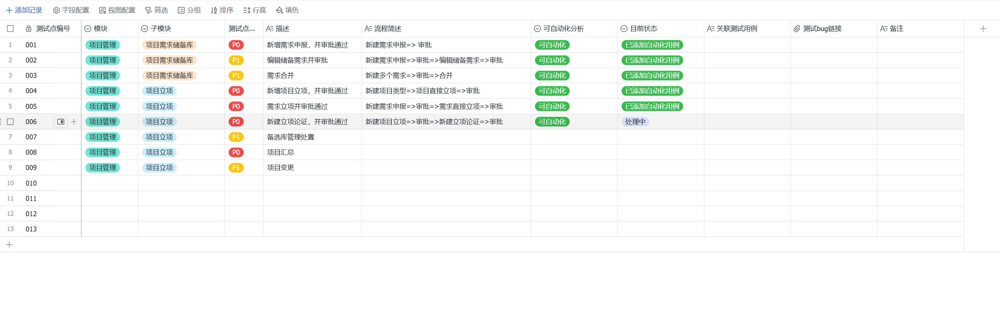
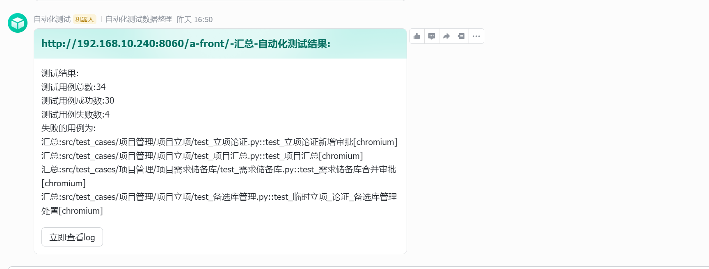
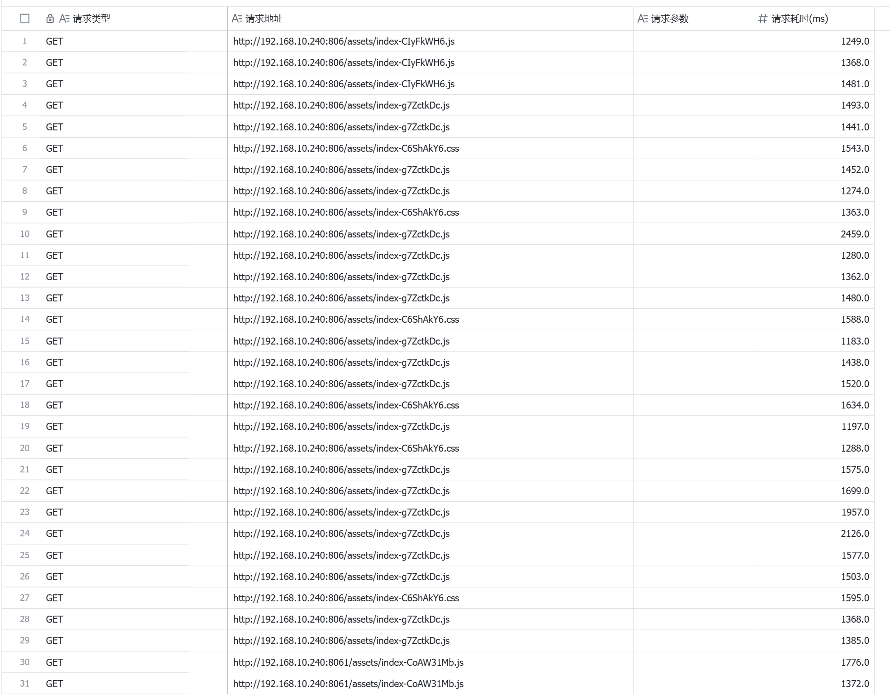

# Web UI 自动化测试项目

## **项目描述**

- 基于playwright 实现的自化测试项目,目标网址:[ARS经济运营管理系统](http://192.168.10.240:806/login)
- 本项目采用Page Object设计模式，实现了页面操作的封装和复用
- 支持数据驱动测试，使用YAML文件管理测试数据
- 集成了Allure报告，提供美观的测试报告展示

## 项目功能

- [x] 基本操作实现封装
- [x] 基于pytest实现页面的封装
- [x] 自动生成测试报告
- [x] 支持文件上传和下载操作
- [x] 支持表格数据验证和操作
- [x] 支持表单自动填写和验证
- [x] 支持飞书发送记录测试结果
- [ ] 使用jenkins 实现自动化继承
- [ ] 实现的页面测试覆盖率的计算
- [ ] 实现docker部署

## 基本要求

| **要素**     | **描述**           |
|------------|------------------|
| **python** | **uv包管理,版本3.11** |
| **浏览器驱动**  | **playwright**   |
| **测试框架**   | **pytest**       |
| **报告工具**   | **allure**       |

## 项目结构

```
auto-web-test/
├── config/                 # 配置文件目录
│   └── settings.py        # 项目配置
├── core/                  # 核心功能模块
│   ├── locators.py       # 元素定位器
│   ├── form.py           # 表单操作
│   ├── table.py          # 表格操作
│   ├── search.py         # 搜索功能
│   └── upload_file.py    # 文件上传功能
├── data/                  # 测试数据目录
│   └── test_users.yaml   # 测试用户数据
├── pages/                 # 页面对象目录
│   ├── base_page.py      # 基础页面类
│   └── login_page.py     # 登录页面类
├── test_cases/           # 测试用例目录
├── utils/                # 工具类目录
│   ├── date_uitl.py     # 日期工具
│   ├── log_util.py      # 日志工具
│   ├── path_util.py     # 路径工具
│   ├── check_util.py    # 检查工具
│   └── global_map.py    # 全局变量管理
├── resources/            # 资源文件目录
├── logs/                 # 日志文件目录
├── pytest.ini           # pytest配置文件
├── pyproject.toml       # 项目依赖配置
└── README.md            # 项目说明文档
```

## 目录说明

### 1. 核心模块 (core/)

- **locators.py**: 提供统一的元素定位方法
- **form.py**: 封装表单相关的操作
- **table.py**: 封装表格相关的操作
- **search.py**: 封装搜索相关的功能
- **upload_file.py**: 封装文件上传和下载功能

### 2. 页面对象 (pages/)

- **base_page.py**: 所有页面类的基类，提供通用方法
- **login_page.py**: 登录页面类，继承自base_page
- 其他页面类: 继承自base_page，实现具体页面的操作

### 3. 测试数据 (data/)

- **test_users.yaml**: 存储测试用户信息，包括用户名、密码等
- 其他YAML文件: 存储不同模块的测试数据

### 4. 工具类 (utils/)

- **date_uitl.py**: 日期处理工具
- **log_util.py**: 日志记录工具
- **path_util.py**: 路径处理工具
- **check_util.py**: 数据检查工具
- **global_map.py**: 全局变量管理工具

### 5. 配置文件 (config/)

- **settings.py**: 项目配置信息，包括环境变量、URL等

### 6. 测试用例 (test_cases/)

存放所有测试用例文件，按模块分类组织

### 7. 资源文件 (resources/)

存放测试所需的资源文件，如图片、文档等

### 8. 日志文件 (logs/)

存放测试执行过程中产生的日志文件

## 技术栈

- Python 3.11
- Playwright
- Pytest
- Allure
- YAML

## 主要功能

1. 基于Page Object模式的页面封装
2. 统一的元素定位策略
3. 完整的表单操作支持
4. 灵活的表格操作
5. 强大的搜索功能
6. 文件上传和下载功能
7. 完善的日志记录
8. 数据驱动测试支持
9. 美观的测试报告

## 使用说明

### 1. 环境准备：

   ```bash
   # 安装Python 3.11
   # 安装uv包管理工具
   pip install uv
   
   # 安装项目依赖
   uv pip install -r requirements.txt
   
   # 安装playwright浏览器
   playwright install
   ```

### 2. 运行测试：

   ```bash
   # 运行所有测试用例
   pytest test_cases/ --alluredir=./allure-results
   
   # 运行指定模块的测试用例
   pytest test_cases/test_module/ --alluredir=./allure-results
   
   # 运行指定测试用例
   pytest test_cases/test_module/test_file.py --alluredir=./allure-results
   ```

### 3. 查看报告：

   ```bash
   # 启动Allure报告服务
   allure serve ./allure-results
   
   # 生成静态报告
   allure generate ./allure-results -o ./allure-report
   ```

### 自动化进度报告[进度报告](https://vcn25s6jh1tk.feishu.cn/base/VRsxbSmHgaKD7jswAAlcPAOlnUx?from=from_copylink)



### 测试结果报告



### 异常接口超时记录[异常接口信息](https://vcn25s6jh1tk.feishu.cn/base/Bk4CbfXQ0adtvmsaSitcDoBrnyc?table=tbl0rIx1AqSP5Ns0&view=vewsx1D6PF)




